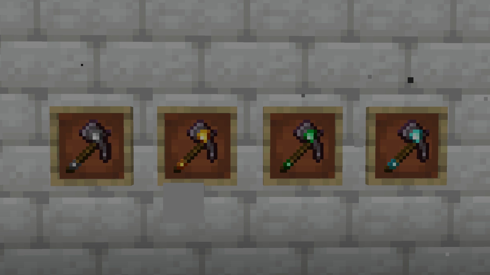
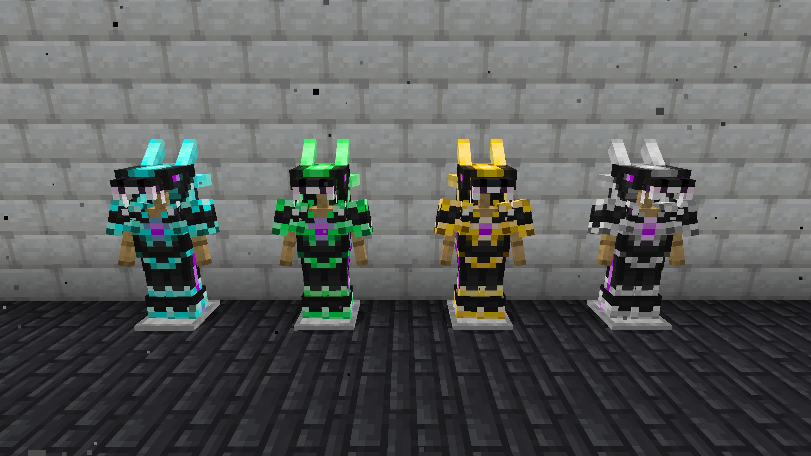
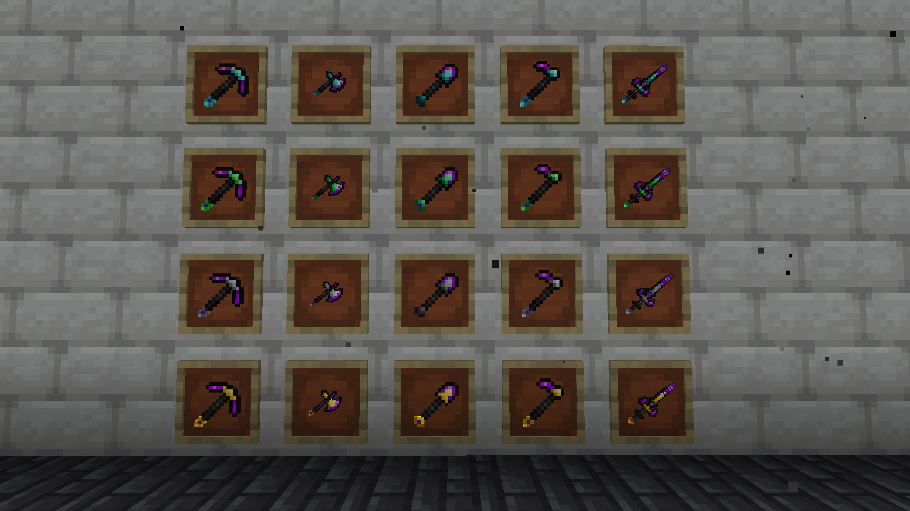

# Many Random Compats

Many Random Compats adds compatibilities between mods that may or may not make sense!

## Advanced Netherite × Easy Emerald Tools

For now, it adds compatibility between [Advanced Netherite](https://modrinth.com/mod/advanced-netherite) and [Easy Emerald Tools](https://www.curseforge.com/minecraft/mc-mods/easy-emerald-tools).

## Advanced Netherite × DragonLoot

It also adds compatibility between [Advanced Netherite](https://modrinth.com/mod/advanced-netherite) and [DragonLoot](https://modrinth.com/mod/dragonloot).

I'm currently working on compatibility with [Everything is Copper](https://modrinth.com/mod/everythingcopper) to add Copper Buckets that work with different fluids from other mods (such as the sugar rivers from Bumblezone), as well as Netherite-Diamond Gloves from [Deep Aether](https://modrinth.com/mod/deep-aether).

So, stay tuned!

- ⛄
